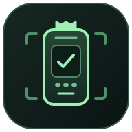

<p align="center">
  
</p>

<h1 align="center">Stone POS Lab</h1>

<p align="center">Laboratório desktop para criar dispositivos Android virtuais com perfis de terminais SmartPOS.</p>

<p align="center">
  <a href="https://docs.flutter.dev/"></a>
  <a href="https://dart.dev/"></a>
  <a href="https://developer.android.com/studio/run/emulator"></a>
  <a href="#executar-no-macos"></a>
  <a href="https://github.com/jeffersonmello/Stone-POS-Lab/actions/workflows/ci.yml"></a>
  <a href="LICENSE"></a>
</p>

O projeto nasceu de uma incompatibilidade observada em uma maquininha Gertec. O laboratório reúne fichas técnicas, documentação e instâncias virtuais para comparar diferenças de hardware, Android e comportamento entre modelos e reproduzir falhas de aplicativos SmartPOS.

## O que você pode fazer

- Buscar e filtrar **12 perfis** e consultar as especificações e fontes de cada modelo.
- Criar, iniciar, encerrar e excluir instâncias pelo Android SDK da sua máquina. A criação permite escolher a imagem Android e revisar as opções de tela.
- Ler guias de integração no aplicativo e baixar cópias locais de quatro referências da Stone pelo botão **Sincronizar fontes**.

## Como funciona

Ao escolher um modelo, o app preenche a API Android e a resolução de referência. Ele procura uma imagem que corresponda à arquitetura do computador e usa o Android SDK local para criar o AVD. O Android Emulator abre em uma janela própria, e o laboratório acompanha a instância via ADB. Execute o mesmo APK em perfis diferentes para descobrir em que etapa o comportamento muda. [Arquitetura](docs/ARCHITECTURE.md)

## Catálogo

| Fabricante | Perfis da matriz do SDK Stone | Perfis legados |
| --- | --- | --- |
| Sunmi | P2-B, P2-A11 | — |
| Positivo | L300, L400, D400 | — |
| Gertec | GPOS 710, GPOS 730, GPOS 760 | GPOS 700X |
| Tectoy | T8 | — |
| Transire | S8s | — |
| Ingenico | — | APOS A8 |

As fichas indicam quando a configuração de referência vem do fabricante e precisa de conferência no terminal Stone. A densidade de tela permanece em aberto quando a fonte não publica o valor usado pelo Android. A sincronização atualiza as páginas de documentação no cache local. Mudanças no catálogo passam por revisão no Git. [Catálogo versionado](data/catalog.json) · [Matriz do SDK Stone](https://sdkandroid.stone.com.br/reference/dispositivos-suportados) · [Stone Connect 2.0](https://ajuda.stone.com.br/connect-20)

## Executar no macOS

O ambiente validado para esta versão usa **Apple Silicon**, **Flutter 3.44**, **Dart 3.12**, **Xcode 27.2** e o Android SDK local.

1. Instale Flutter, configure o Xcode e confira a configuração do macOS com `flutter doctor -v`. [Guia oficial do Flutter para macOS](https://docs.flutter.dev/platform-integration/macos/setup)
2. No **SDK Manager** do Android Studio, instale **Android Emulator**, **Android SDK Platform-Tools** e **Android SDK Command-line Tools**. O laboratório procura o SDK em `ANDROID_HOME`, `ANDROID_SDK_ROOT` e `~/Library/Android/sdk`. [Ferramentas de linha de comando do Android](https://developer.android.com/tools)
3. Clone e execute o projeto.

   ```sh
   git clone https://github.com/jeffersonmello/Stone-POS-Lab.git
   cd Stone-POS-Lab
   flutter pub get
   flutter run -d macos
   ```

4. Abra o **Catálogo**, selecione um modelo e clique em **Criar emulador**. Se a imagem ainda estiver ausente, baixe a imagem sugerida no diálogo. Se o Android SDK solicitar aceite de licença, revise os termos no SDK Manager.
5. Abra **Minhas instâncias** e inicie a instância criada. Para testar seu próprio APK, use o [ADB do Android SDK](https://developer.android.com/tools/adb).

### Gerar o aplicativo

```sh
FLUTTER_XCODE_ARCHS=arm64 flutter build macos --release
open "build/macos/Build/Products/Release/Stone POS Lab.app"
```

Os registros de instâncias e as cópias da documentação ficam em `~/Library/Application Support/Stone POS Lab`. As imagens de sistema e os AVDs ficam nos diretórios gerenciados pelo Android SDK.

## Escopo da emulação

Use o AVD para testar instalação, inicialização, interface e fluxos disponíveis na imagem Android. Inserção e aproximação de cartão, leitura NFC/MIFARE e impressão física exigem uma maquininha. A validação de um modelo combina os testes virtuais com os de bancada, incluindo firmware e os fluxos transacionais com o sandbox da Stone. Uma futura simulação com os apps oficiais em instâncias virtuais depende de liberação pela Stone e de compatibilidade com a imagem. [Limitações do Android Emulator](https://developer.android.com/studio/run/advanced-emulator-usage#limitations) · [Configuração de apps Stone](https://sdkandroid.stone.com.br/reference/configuracao-deeplink)

## Contribuir

Para sugerir uma correção de perfil, inclua o modelo, a revisão de hardware ou firmware quando disponível e uma fonte verificável. Para relatar um problema com AVD, inclua a versão do macOS, a arquitetura do host, a versão do Android Emulator, o identificador da imagem e os passos para reproduzir.

```sh
dart format --output=none --set-exit-if-changed lib test
flutter analyze
flutter test
```

[Guia de contribuição](CONTRIBUTING.md) · [Especificações](specs/README.md) · [Instruções e skills para agentes](AGENTS.md) · [Agente revisor](.codex/agents/pos-compatibility-review.toml)

## Licença

Projeto independente sob a [licença MIT](LICENSE). Os nomes Stone e dos fabricantes identificam os dispositivos e as integrações documentadas.
