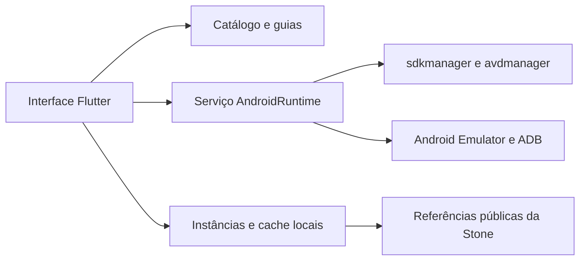

# Arquitetura

O Stone POS Lab usa Flutter e Dart para gerenciar dispositivos virtuais Android locais. O projeto mantém as fichas de referência e usa os executáveis da instalação do Android SDK para criar e operar as instâncias.

## Componentes

| Componente | Responsabilidade |
| --- | --- |
| [Catálogo](../data/catalog.json) | Modelo, API, resolução, densidade quando conhecida, especificações e fontes de hardware. |
| [Catálogo e criação](../lib/catalog_page.dart) | Seleção de perfil e ficha técnica. O [formulário](../lib/create_dialog.dart) preenche a API e a tela e apresenta imagens instaladas compatíveis com o host. |
| [AndroidRuntime](../lib/android_runtime.dart) | Descobre o SDK, instala imagens sob solicitação, cria AVDs e controla as instâncias próprias com Android Emulator e ADB. |
| [LabStorage](../lib/lab_data.dart) | Persiste a lista de instâncias e atualiza o cache das referências da Stone. Os [guias do projeto](../data/guides/) fazem parte do app. |

## Criação e execução

1. A pessoa escolhe um perfil e uma imagem instalada. O app oferece o download pelo SDK Manager quando a imagem AOSP compatível está ausente.
2. O serviço cria um AVD com nome próprio iniciado por `poslab_`. Ele aplica as dimensões e a densidade quando foram preenchidas. Campos vazios mantêm os valores da configuração padrão do AVD.
3. O Android Emulator abre em uma janela própria. A lista usa o nome do AVD reportado pelo ADB para acompanhar o estado de execução.
4. O Android SDK guarda a imagem e o AVD. O aplicativo registra o vínculo entre instância, perfil e imagem em `~/Library/Application Support/Stone POS Lab/instances.json`.

## O que o perfil descreve

A API pertence à imagem Android selecionada. Resolução e densidade são propriedades do AVD. Memória, leitora, NFC/MIFARE, impressão e outras características físicas listadas na ficha ajudam a comparar modelos e planejar testes de bancada. Confirme revisões de firmware e características do equipamento quando a fonte se refere ao catálogo genérico do fabricante.

A sincronização atualiza quatro referências públicas da Stone no cache local para leitura offline. Alterações de especificação no [catálogo](../data/catalog.json) passam por revisão de fonte e de variante, conforme o [fluxo de especificações](../specs/README.md).

[Perfis de AVD](https://developer.android.com/studio/run/managing-avds) · [ADB](https://developer.android.com/tools/adb) · [Modelos Stone](https://sdkandroid.stone.com.br/reference/dispositivos-suportados)
